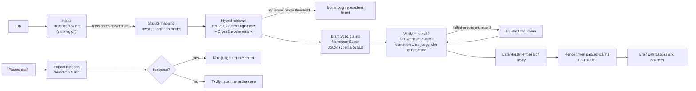

# CourtroomAI: a verification-first co-pilot for Indian advocates

CourtroomAI turns an FIR into a case brief in which **every sentence traces to a claim that passed a check against its source**, and audits the citations in any pasted draft. It runs on NVIDIA Nemotron models served by Nebius Token Factory, with Tavily for web search.

> Not legal advice. CourtroomAI is an assistive tool; check every source before relying on it.

Built for the Nebius x NVIDIA Global AI Hackathon, Best Apps and Agents track.

**Live demo:** https://courtroomai-khaki.vercel.app (API hosted on AWS EC2; first brief takes about a minute)

<!-- SCREENSHOT: brief view with badges and an expanded source passage -->
<!-- SCREENSHOT: audit view catching a fabricated citation -->
<!-- SCREENSHOT: live step trace naming the model at each step -->

## The problem

AI research tools can cite cases that do not exist, or cases that do not say what the draft claims. On 2 July 2026 the Supreme Court of India held: *"It is a misconduct on the part of an advocate to cite such judgments without verification"* (*Pooja Ramesh Singh v. Jammu and Kashmir Bank Ltd.*, Civil Appeal No. 11950 of 2025, para 7). Stanford researchers found that commercial legal AI tools hallucinate in 1 out of 6 or more benchmark queries (Stanford RegLab / HAI, 2024). CourtroomAI does not try to make the model more careful. Instead, the model is only allowed to propose **typed claims**, and code decides which claims reach the advocate.

## Two modes

**Brief mode.** Paste an FIR. Out comes a brief made only of claims that passed:

| Claim type | How it is checked | If the check fails |
|---|---|---|
| Fact | The quoted text is a verbatim substring of the FIR (after whitespace and Unicode normalisation only) | Failed; listed as not found in the FIR |
| Statute mapping | Lookup in the official IPC→BNS correspondence table (CAPT Bhopal, MHA), cross-checked against Indian Kanoon; CrPC→BNSS and Evidence Act→BSA from Indian Kanoon's per-section notes. The applicable code is chosen by offence date (new codes from 1 July 2024). Never from model memory | Unverified ("no mapping found"); if the two sources differ, shown as only partly supported |
| Precedent holding | (a) case ID exists in the corpus, (b) quoted passage is verbatim in the stored judgment, (c) Nemotron Ultra judges support and must quote its evidence, and that quote is itself checked verbatim | Retried twice, then failed and kept out of the brief |
| Later treatment | Built only from Tavily results with links. Never says "good law" | "No later treatment found in the sources searched" |
| Strategy suggestion | Must reference only passed claims, is labelled a suggestion, and may not add any case name or figure | Dropped |

A final **output lint** extracts every case name, citation, section number, date and number from the rendered brief; any sentence containing one that is not in the FIR or in a passed claim's source is removed and logged. Any timeout, parse error or missing source ends in "unverified", never "passed". If retrieval is weak, the system says "not enough precedent found" instead of drafting.

**Audit mode.** Paste any draft, including one written by another AI. Nemotron Nano extracts each citation and the proposition it is cited for. Each one is resolved against the corpus by reporter citation or case name and checked by the same judge with quote-back. Citations outside our library are searched with **Tavily Search**; if a trusted full-judgment page is found (Indian Kanoon `/doc/` pages, Supreme Court and High Court sites), its full text is fetched with **Tavily Extract** and put through exactly the same checks, and the verdict says where the text came from. If the judgment cannot be read, a web result that names the case gives "found online, not verified against the judgment text"; otherwise "not found".

## Architecture



| Layer | Choice |
|---|---|
| Models | NVIDIA Nemotron 3 Nano (`nvidia/NVIDIA-Nemotron-3-Nano-30B-A3B`) for extraction, Super (`nvidia/nemotron-3-super-120b-a12b`) for drafting, Ultra (`nvidia/Nemotron-3-Ultra-550b-a55b`) for judging, with automatic fallback from Ultra to Super recorded in the output |
| Inference | Nebius Token Factory, OpenAI-compatible API (`core/llm.py`); `response_format: json_schema` on every structured call, pydantic validation, one repair, else fail closed |
| Orchestration | LangGraph (`core/pipeline.py`) |
| Retrieval | `rank_bm25` + Chroma with `BAAI/bge-base-en-v1.5`, reranked by `cross-encoder/ms-marco-MiniLM-L-6-v2` |
| Search | Tavily at runtime: **Search** for later treatment and audit lookups, **Extract** to read judgments outside our library |
| Backend | FastAPI; `/api/brief` and `/api/audit` stream each step as server-sent events; request size limit, per-IP rate limit, daily cap from logged tokens |
| Frontend | React + Vite + Tailwind; brief view, audit view, live trace |

Where each Nemotron model is called: Nano in `core/pipeline.py:intake_node` and `core/audit.py:run_audit`; Super in `draft_node` and `redraft_node`; Ultra in `make_judge` (brief) and `run_audit` (audit). Every runtime LLM call goes through `core/llm.py` to Token Factory; CI fails if any other provider is imported.

## Evaluation

26 synthetic FIRs (fictional people) across the corpus topics, split 9 dev / 17 test by case-ID hash; thresholds are tuned on dev only. Every case runs intake → retrieval → drafting once, then the verifier **off** (drafted claims shown unchecked) and **on**. A fabricated precedent with a non-existent case ID is injected into every case, and each audit draft carries one real corpus citation and one labelled fake. Relevance labels are topic labels (the judgments fetched under the same Indian Kanoon query in the first 100-judgment batch), not hand-judged relevance; judgments added later are unlabelled, so context precision understates retrieval. Percentages carry Wilson 95% intervals because the set is small. The table below is generated by `eval/make_table.py` from the newest `eval/results/eval_*.json`; nothing in it is typed by hand.

<!-- EVAL:START -->
Source: `eval/results/eval_20261028T030642Z.json` · git `554d611` · split `all` · 26 cases · Nano `nvidia/NVIDIA-Nemotron-3-Nano-30B-A3B`, Super `nvidia/nemotron-3-super-120b-a12b`, Ultra `nvidia/Nemotron-3-Ultra-550b-a55b`

| Metric | Result |
|---|---|
| Injected fabricated precedent caught (brief, verifier on) | 26/26 = 100.0% (95% CI 87.1–100.0%) |
| Injected fabricated precedent shown (brief, verifier off) | 26/26 = 100.0% (95% CI 87.1–100.0%) |
| Fabricated citation caught (audit mode) | 26/26 = 100.0% (95% CI 87.1–100.0%) |
| Real citation resolved to the right judgment (audit mode) | 25/26 = 96.2% (95% CI 81.1–99.3%) |
| Audit-mode accuracy per citation (real resolved + fake caught) | 51/52 = 98.1% (95% CI 89.9–99.7%) |
| Unsupported precedent/strategy claims shown, verifier off | 85/172 = 49.4% (95% CI 42.0–56.8%) |
| Unsupported precedent/strategy claims shown, verifier on | 0/87 = 0.0% (95% CI 0.0–4.2%) |
| Narrative leakage in final output (goal: 0) | sentences with unknown entities: 0, cases: 26 |
| Drafted precedent claims that passed all checks | 44/70 = 62.9% (95% CI 51.1–73.2%) |
| Drafted precedent claims rejected or unverified | 26/70 = 37.1% (95% CI 26.8–48.9%) |
| False rejection rate | needs hand labels (see human_check CSV) |
| Context precision@k (formula as RAGAS; topic labels, not hand labels) | 0.553 |
| Precedents with later-treatment web results | 31/33 = 93.9% (95% CI 80.4–98.3%) |
| Median latency per brief (s, verifier on) | 50.5 |
| Median Token Factory tokens per brief | 27872.0 |
| Cases that abstained | 0 |
| Errored runs | 0 |

Abstention threshold used: `1.3651`; tuned on dev: `{'threshold': 2.0624, 'dev_accuracy': 1.0, 'n': 9}`.
<!-- EVAL:END -->

How to read it: with the verifier on, only passed claims are shown, so "unsupported shown, verifier on" is zero by construction; the informative number is how many drafted claims the verifier removes (verifier off). "Injected fabricated precedent shown, verifier off" is the baseline by design. In audit mode the eval drafts cite each real case for a vague point, so the real-citation row measures only that the right judgment was found, not that it supports the point. The abstention threshold is tuned on the dev split only; all dev cases are on topics the library covers, so it is set just below the lowest dev score and has not been tested on deliberately off-topic FIRs.

A hand check of 20 passed precedent claims is exported to `eval/results/human_check_*.csv`; the false rejection rate needs those labels.

## Setup

Requirements: Python 3.11, Node 20+.

```bash
python3.11 -m venv .venv && .venv/bin/pip install -r requirements.txt
cp .env.example .env    # then fill in values; never commit .env
.venv/bin/python scripts/check_env.py
```

Environment variable names (values live only in `.env` or the host's secret store):

| Name | Used for |
|---|---|
| `TOKEN_FACTORY_API_KEY`, `TOKEN_FACTORY_BASE_URL` | Nebius Token Factory |
| `NEMOTRON_NANO_MODEL`, `NEMOTRON_SUPER_MODEL`, `NEMOTRON_ULTRA_MODEL` | model IDs, checked against the live model list by `check_env.py` |
| `TAVILY_API_KEY` | Tavily search |
| `INDIANKANOON_API_TOKEN` | only for re-running ingestion |
| optional: `DAILY_SPEND_CAP_USD`, `DAILY_TOKEN_CAP`, `RATE_LIMIT_PER_MIN`, `RATE_LIMIT_PER_DAY`, `MAX_BODY_BYTES`, `ABSTAIN_RERANK_THRESHOLD`, `TF_PRICE_IN_<ROLE>` / `TF_PRICE_OUT_<ROLE>` | guards and cost reporting |

Data is not in git. See [docs/DATA.md](docs/DATA.md): fetch with `python -m ingestion.kanoon_fetcher`, embed with `python -m ingestion.embedder`, then `python scripts/build_judgments.py`. Statute tables: `python scripts/fetch_acts.py` (six Acts, one Indian Kanoon call each), then `python scripts/build_statute_map.py <path to the CAPT Bhopal PDF>`.

## Run, test, evaluate

```bash
.venv/bin/uvicorn backend.main:app --port 8000          # API
cd frontend && npm ci && npm run dev                     # UI (VITE_API_URL defaults to localhost:8000)
.venv/bin/python scripts/run_brief.py samples/fir_dowry.txt
.venv/bin/python scripts/run_audit.py samples/draft_audit_demo.txt
.venv/bin/python -m pytest -q                            # live tests skip without keys
.venv/bin/python eval/run_eval.py && .venv/bin/python eval/make_table.py
```

## Data sources and licences

- Judgments and Act texts: Indian Kanoon API; each judgment links back to its Indian Kanoon page. Terms of reuse to be confirmed by the project owner.
- IPC→BNS correspondence table: CAPT Bhopal (Central Academy for Police Training, MHA), public PDF hosted by Kerala Prisons; every row cites its page (`scripts/build_statute_map.py`).
- CrPC→BNSS and Evidence Act→BSA: Indian Kanoon's editorial notes in the Act texts (labelled as such in the app).
- Embedding model `BAAI/bge-base-en-v1.5` (MIT); reranker `cross-encoder/ms-marco-MiniLM-L-6-v2` (Apache 2.0).
- Code: MIT ([LICENSE](LICENSE)).

## Limitations

- **Small library.** See the counts below. Many FIRs will find nothing close enough, and the system says so rather than stretching. Audit mode can read judgments outside the library when a trusted copy is online.

<!-- CORPUS:START -->
- Judgment library: **295 judgments** (67 with reporter citations), split into **17907 searchable passages**.
- Statute tables: **525 IPC→BNS** rows from the official CAPT Bhopal correspondence table (cross-checked with Indian Kanoon: 426 agree, 3 differ and are shown as only partly supported), **519 CrPC→BNSS** and **175 Evidence Act→BSA** rows from Indian Kanoon's per-section notes.
_Counted from `data/` by `eval/make_table.py`._
<!-- CORPUS:END -->
- **Selection bias.** Published judgments over-represent appeals and reported cases; they are not a sample of how cases are decided.
- **The judge is a model.** The verbatim checks are deterministic, but whether a passage *supports* a proposition is a Nemotron Ultra judgement. Its quote is checked; its reading is not infallible.
- **No outcome prediction.** CourtroomAI does not forecast results.
- **Not legal advice.**

Feedback on Token Factory, Nemotron and Tavily: [FEEDBACK.md](FEEDBACK.md).
